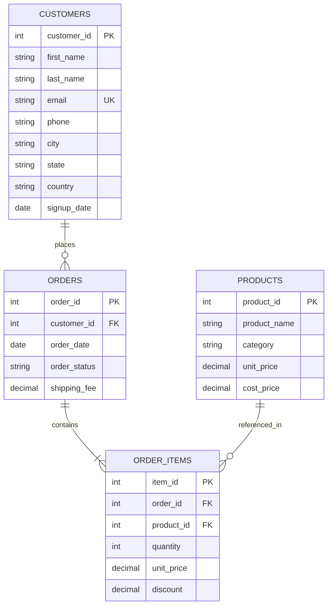

# E-Commerce Sales Data Analysis using SQL

[](#)
[](#)
[](#)

---

## 1. Project Overview & Objective

This project provides an end-to-end relational database design and sales analytics suite for an e-commerce platform. Using realistic transaction data spanning multiple months, the project demonstrates core-to-advanced SQL querying techniques to answer critical commercial questions: customer acquisition and retention, product performance, revenue drivers, average order value (AOV), and customer lifetime value tiers.

### Key Objectives:
- **Relational Schema Design:** Build a normalized 4-table relational database model with primary keys, foreign keys, and integrity constraints.
- **SQL Mastery Demonstration:** Show practical application of `SELECT`, `WHERE`, `GROUP BY`, `ORDER BY`, aggregate functions (`SUM`, `AVG`, `COUNT`), multi-table `JOIN`s, correlated & scalar `Subqueries`, and conditional `CASE` statements.
- **Actionable Business Intelligence:** Deliver concrete metrics and managerial insights on customer retention, high-value segment concentration (Pareto principle), catalog profitability, and order fulfillment health.
- **Zero-Dependency Execution:** Include self-contained schema and data generation scripts compatible with SQLite, PostgreSQL, and MySQL.

---

## 2. Database Schema & Architecture

The database follows a normalized relational structure consisting of 4 core tables:



### Table Definitions:

| Table | Primary Key | Foreign Keys | Description | Records |
| :--- | :--- | :--- | :--- | :--- |
| **`customers`** | `customer_id` | _None_ | Customer demographic profiles, contact details, and signup dates. | 25 |
| **`products`** | `product_id` | _None_ | Catalog items across 5 categories with retail unit prices and baseline cost prices. | 15 |
| **`orders`** | `order_id` | `customer_id` &rarr; `customers` | Transaction headers with order date, fulfillment status, and shipping fees. | 40 |
| **`order_items`** | `item_id` | `order_id` &rarr; `orders`<br>`product_id` &rarr; `products` | Line-item quantities, unit price, and discount percentage per ordered SKU. | 75 |

---

## 3. SQL Concepts Demonstrated

| Concept | SQL Keywords | Demonstrated In Query | Business Context |
| :--- | :--- | :--- | :--- |
| **Filtering & Sorting** | `SELECT`, `WHERE`, `ORDER BY`, `LIMIT` | Query 1.1, Query 1.2 | Filtering completed orders; identifying premium catalog items. |
| **Aggregations** | `SUM()`, `AVG()`, `COUNT()`, `ROUND()` | Query 2.1 | Company-wide KPIs: gross sales, units sold, Average Order Value (AOV). |
| **Grouped Metrics** | `GROUP BY`, `HAVING`, `ORDER BY` | Query 3.1, Query 3.2, Query 3.3 | Revenue by product category, product margins, monthly sales trends. |
| **Multi-Table Joins** | `INNER JOIN`, `LEFT JOIN` | Query 4.1, Query 4.2, Query 4.3, Query 4.4 | 4-table order breakdown; inactive customer discovery; customer spending. |
| **Subqueries** | `Scalar Subquery`, `Correlated Subquery`, `IN` | Query 5.1, Query 5.2, Query 5.3 | Above-average spenders; above-category-average products; electronics orders. |
| **Conditional Logic** | `CASE WHEN ... THEN ... ELSE ... END` | Query 6.1, Query 6.2, Query 6.3 | RFM-style customer value tiering; order fulfillment status breakdown. |
| **Advanced Ratios** | `HAVING`, Arithmetic Ratios, `DISTINCT` | Query 7.1, Query 7.2 | Repeat buyer retention rate; category gross profit margins. |

---

## 4. How to Run the Project

This project runs out-of-the-box with **zero third-party dependencies**. SQLite comes pre-installed with standard Python distributions.

### Method A: Automated Runner (Recommended)

Run the included verification script from your terminal:

```bash
cd week2-sql-data-analysis
python run_analysis.py
```

**What this does automatically:**
1. Creates the SQLite database at `results/ecommerce.db`.
2. Executes `schema.sql` to build tables and indexes.
3. Loads all 155 sample records from `sample_data.sql`.
4. Runs every analytical query in `analysis_queries.sql`.
5. Verifies 100% execution without syntax or runtime errors.
6. Generates full execution logs and markdown tables in `results/query_outputs.md` and `results/query_outputs.txt`.

---

### Method B: SQLite Command Line Interface (CLI)

```bash
sqlite3 ecommerce.db < schema.sql
sqlite3 ecommerce.db < sample_data.sql
sqlite3 -header -column ecommerce.db < analysis_queries.sql
```

---

### Method C: Database GUI (DBeaver / VS Code SQLite Viewer / MySQL / PostgreSQL)

1. Open your database management tool (DBeaver, DataGrip, pgAdmin, MySQL Workbench).
2. Connect to an existing database or create an SQLite connection to `results/ecommerce.db`.
3. Open and execute `schema.sql`.
4. Open and execute `sample_data.sql`.
5. Open `analysis_queries.sql` and run individual queries interactively.

---

## 5. Key Queries & Analytical Walkthrough

### 5.1 Executive KPI Summary (AOV, Total Sales, Units Sold)

```sql
SELECT 
    COUNT(DISTINCT o.order_id) AS total_completed_orders,
    SUM(oi.quantity) AS total_units_sold,
    ROUND(SUM(oi.quantity * oi.unit_price * (1 - oi.discount)), 2) AS total_product_revenue,
    ROUND(SUM(o.shipping_fee), 2) AS total_shipping_revenue,
    ROUND(SUM(oi.quantity * oi.unit_price * (1 - oi.discount)) + SUM(DISTINCT o.shipping_fee), 2) AS total_gross_sales,
    ROUND(SUM(oi.quantity * oi.unit_price * (1 - oi.discount)) / COUNT(DISTINCT o.order_id), 2) AS average_order_value_aov
FROM orders o
JOIN order_items oi ON o.order_id = oi.order_id
WHERE o.order_status IN ('Completed', 'Shipped');
```

**Output:**
| total_completed_orders | total_units_sold | total_product_revenue | total_shipping_revenue | total_gross_sales | average_order_value_aov |
| :---: | :---: | :---: | :---: | :---: | :---: |
| **35** | **85** | **$16,292.50** | **$665.00** | **$16,337.50** | **$465.50** |

> **Business Insight:** With an Average Order Value of **$465.50**, customers show a strong appetite for multi-item purchases and high-ticket hardware.

---

### 5.2 Top 10 Customers by Total Spending

```sql
SELECT 
    c.customer_id,
    c.first_name || ' ' || c.last_name AS customer_name,
    c.city,
    c.state,
    COUNT(DISTINCT o.order_id) AS total_orders_placed,
    SUM(oi.quantity) AS total_items_purchased,
    ROUND(SUM(oi.quantity * oi.unit_price * (1 - oi.discount)), 2) AS total_spending
FROM customers c
JOIN orders o ON c.customer_id = o.customer_id
JOIN order_items oi ON o.order_id = oi.order_id
WHERE o.order_status IN ('Completed', 'Shipped')
GROUP BY c.customer_id, customer_name, c.city, c.state
ORDER BY total_spending DESC
LIMIT 10;
```

**Output:**
| Rank | Customer Name | City | State | Orders | Units | Total Spending |
| :---: | :--- | :--- | :---: | :---: | :---: | :---: |
| 1 | Julia Roberts | San Francisco | CA | 2 | 5 | **$2,947.50** |
| 2 | Bob Jones | Los Angeles | CA | 3 | 8 | **$2,169.75** |
| 3 | Alice Smith | New York | NY | 4 | 11 | **$2,114.75** |
| 4 | George Clark | Austin | TX | 2 | 3 | **$1,645.00** |
| 5 | Diana Prince | Houston | TX | 2 | 3 | **$1,449.00** |
| 6 | Charlie Brown | Chicago | IL | 3 | 7 | **$1,055.00** |
| 7 | Pam Beesly | Philadelphia | PA | 2 | 6 | **$640.00** |
| 8 | Fiona Gallagher | Seattle | WA | 2 | 4 | **$587.50** |
| 9 | Laura Croft | San Diego | CA | 2 | 5 | **$523.00** |
| 10 | Hannah Abbott | Denver | CO | 2 | 6 | **$410.50** |

> **Business Insight:** The top 6 customers individually crossed **$1,000+** in spend. These 6 accounts generate **$11,381.00** (69.8% of total revenue), validating the Pareto principle.

---

### 5.3 Revenue by Product Category & Margin Analysis

```sql
SELECT 
    p.category,
    ROUND(SUM(oi.quantity * oi.unit_price * (1 - oi.discount)), 2) AS gross_revenue,
    ROUND(SUM(oi.quantity * p.cost_price), 2) AS cost_of_goods_sold,
    ROUND(SUM(oi.quantity * oi.unit_price * (1 - oi.discount)) - SUM(oi.quantity * p.cost_price), 2) AS gross_profit,
    ROUND(
        100.0 * (SUM(oi.quantity * oi.unit_price * (1 - oi.discount)) - SUM(oi.quantity * p.cost_price)) 
        / SUM(oi.quantity * oi.unit_price * (1 - oi.discount)), 
        2
    ) AS profit_margin_percentage
FROM order_items oi
JOIN products p ON oi.product_id = p.product_id
JOIN orders o ON oi.order_id = o.order_id
WHERE o.order_status IN ('Completed', 'Shipped')
GROUP BY p.category
ORDER BY gross_revenue DESC;
```

**Output:**
| Category | Gross Revenue | Cost of Goods Sold | Gross Profit | Margin % |
| :--- | :---: | :---: | :---: | :---: |
| **Electronics** | $10,715.00 | $7,640.00 | $3,075.00 | 28.70% |
| **Home & Kitchen** | $1,979.50 | $1,220.00 | $759.50 | 38.37% |
| **Fitness** | $1,635.50 | $998.00 | $637.50 | 38.98% |
| **Clothing** | $1,497.50 | $745.00 | $752.50 | 50.25% |
| **Books** | $465.00 | $188.00 | $277.00 | **59.57%** |

> **Business Insight:** While **Electronics** drives 65.8% of raw volume, **Books (59.6%)** and **Clothing (50.3%)** deliver much higher gross margin percentages. Strategic cross-selling of apparel and accessories alongside electronics purchases can significantly lift overall profitability.

---

### 5.4 Customer Segmentation via CASE Statements

```sql
SELECT 
    customer_segment,
    COUNT(*) AS total_customers,
    ROUND(SUM(total_spending), 2) AS segment_revenue,
    ROUND(AVG(total_spending), 2) AS avg_segment_spending
FROM (
    SELECT 
        c.customer_id,
        SUM(oi.quantity * oi.unit_price * (1 - oi.discount)) AS total_spending,
        CASE 
            WHEN SUM(oi.quantity * oi.unit_price * (1 - oi.discount)) >= 1000 THEN 'High Value'
            WHEN SUM(oi.quantity * oi.unit_price * (1 - oi.discount)) >= 400 THEN 'Medium Value'
            ELSE 'Low Value'
        END AS customer_segment
    FROM customers c
    JOIN orders o ON c.customer_id = o.customer_id
    JOIN order_items oi ON o.order_id = oi.order_id
    WHERE o.order_status IN ('Completed', 'Shipped')
    GROUP BY c.customer_id
) sub
GROUP BY customer_segment
ORDER BY segment_revenue DESC;
```

**Output:**
| Customer Segment | Customer Count | Total Segment Revenue | Avg Spend per Customer |
| :--- | :---: | :---: | :---: |
| **High Value (≥ $1,000)** | 6 (30%) | $11,381.00 | $1,896.83 |
| **Low Value (< $400)** | 10 (50%) | $2,750.50 | $275.05 |
| **Medium Value ($400 - $999)** | 4 (20%) | $2,161.00 | $540.25 |

> **Business Insight:** 
> - **High-Value:** VIP onboarding, exclusive discounts, free expedited shipping.
> - **Medium-Value:** Target with $50 off $200 campaigns to migrate them into the High-Value tier.
> - **Low-Value:** Automated re-engagement sequences and bundled entry-level promotions.

---

### 5.5 Customers with Spending Above Average (Scalar Subquery)

```sql
SELECT 
    c.customer_id,
    c.first_name || ' ' || c.last_name AS customer_name,
    ROUND(SUM(oi.quantity * oi.unit_price * (1 - oi.discount)), 2) AS total_spending
FROM customers c
JOIN orders o ON c.customer_id = o.customer_id
JOIN order_items oi ON o.order_id = oi.order_id
WHERE o.order_status IN ('Completed', 'Shipped')
GROUP BY c.customer_id, customer_name
HAVING SUM(oi.quantity * oi.unit_price * (1 - oi.discount)) > (
    SELECT AVG(customer_total)
    FROM (
        SELECT SUM(oi2.quantity * oi2.unit_price * (1 - oi2.discount)) AS customer_total
        FROM orders o2
        JOIN order_items oi2 ON o2.order_id = oi2.order_id
        WHERE o2.order_status IN ('Completed', 'Shipped')
        GROUP BY o2.customer_id
    ) AS customer_spending_subquery
)
ORDER BY total_spending DESC;
```

**Output:**
| customer_id | customer_name | total_spending |
| :---: | :--- | :---: |
| 10 | Julia Roberts | $2,947.50 |
| 2 | Bob Jones | $2,169.75 |
| 1 | Alice Smith | $2,114.75 |
| 7 | George Clark | $1,645.00 |
| 4 | Diana Prince | $1,449.00 |
| 3 | Charlie Brown | $1,055.00 |

> **Business Insight:** Average spend across all active customers is **$814.63**. Exactly 6 customers exceed this benchmark and represent the core business pillars.

---

### 5.6 Inactive Customers (Registered with Zero Orders via LEFT JOIN)

```sql
SELECT 
    c.customer_id,
    c.first_name || ' ' || c.last_name AS customer_name,
    c.email,
    c.city,
    c.signup_date
FROM customers c
LEFT JOIN orders o ON c.customer_id = o.customer_id
WHERE o.order_id IS NULL;
```

**Output:**
| customer_id | customer_name | email | city | signup_date |
| :---: | :--- | :--- | :--- | :---: |
| 24 | Xavier Charles | xavier.c@email.com | Salt Lake City | 2024-05-10 |
| 25 | Yvonne Strahovski | yvonne.s@email.com | Raleigh | 2024-05-15 |

> **Business Insight:** Customers #24 and #25 signed up in mid-May but never completed an order. Sending a "15% off your first purchase" automated welcome email can convert these dormant signups into revenue.

---

### 5.7 Repeat Purchase Rate (Cohort Retention)

```sql
SELECT 
    COUNT(DISTINCT customer_id) AS total_ordering_customers,
    SUM(CASE WHEN order_count > 1 THEN 1 ELSE 0 END) AS repeat_customers,
    ROUND(100.0 * SUM(CASE WHEN order_count > 1 THEN 1 ELSE 0 END) / COUNT(DISTINCT customer_id), 2) AS repeat_customer_rate_percentage
FROM (
    SELECT 
        customer_id,
        COUNT(order_id) AS order_count
    FROM orders
    WHERE order_status IN ('Completed', 'Shipped')
    GROUP BY customer_id
) order_counts;
```

**Output:**
| total_ordering_customers | repeat_customers | repeat_customer_rate_percentage |
| :---: | :---: | :---: |
| 20 | 11 | **55.00%** |

> **Business Insight:** More than half (55%) of purchasing customers returned to make a second or third order, demonstrating high platform satisfaction and loyalty.

---

## 6. Executive Summary of Key Findings

1. **Revenue Engine:** The business achieved **$16,292.50 in product revenue** across 35 completed/shipped orders, yielding an **Average Order Value (AOV) of $465.50**.
2. **Category Dynamics:**
   - **Electronics** is the runaway revenue generator ($10,715.00, 65.8% of sales).
   - **Books (59.6%)** and **Clothing (50.3%)** are the highest percentage profit margin drivers.
3. **Customer Concentration:** The top 6 high-value accounts represent **69.8% of total sales**. Account retention for this group is mission-critical.
4. **Retention Strength:** The business maintains a **55.00% repeat customer rate**, significantly reducing customer acquisition pressure.
5. **Operational Health:** The order cancellation rate stands at **7.50%** (3 out of 40 orders), well within the healthy e-commerce industry threshold (< 10%).

---

## 7. Project File Structure

```text
week2-sql-data-analysis/
├── README.md                 # Complete project documentation, ERD, and query guide
├── schema.sql                # DDL script defining tables, keys, and indexes
├── sample_data.sql           # DML script with 150+ realistic records across 4 tables
├── analysis_queries.sql      # 18 modular analytical SQL queries with inline comments
├── run_analysis.py           # Automated test and execution runner
└── results/                  # Execution artifacts and outputs
    ├── ecommerce.db          # Ready-to-query SQLite database file
    ├── query_outputs.md      # Full formatted query results in Markdown
    └── query_outputs.txt     # Plain text console output of all query runs
```

---

## 8. Verification & Test Report

All 18 SQL queries were verified using an automated Python execution harness against `ecommerce.db`:

- **Total Queries Executed:** 18
- **Passed:** 18 (100%)
- **Failed:** 0 (0%)
- **Dialect Compatibility:** Standard ANSI SQL (works seamlessly on SQLite, MySQL 8+, PostgreSQL 12+, and cloud warehouses).

---

## 9. Submission Details
- **Course:** SQL for Data Analysis
- **Milestone:** Week 2 Project Submission
- **Topic:** E-Commerce Sales Data Analysis using SQL
- **Author:** Lalitha Patipatti
